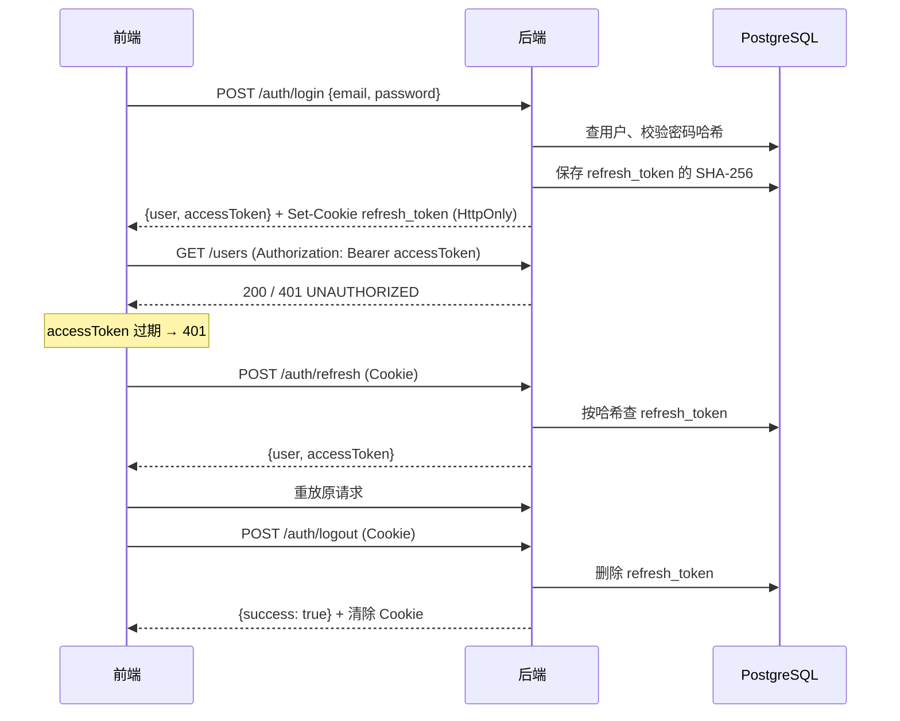

# 架构

5 个模板用不同语言实现**同一套分层和同一份接口契约**（[API_CONTRACT.md](API_CONTRACT.md)）。换技术栈时，只有语言写法不同，目录语义、请求链路、错误处理方式一致。

## 分层

```text
HTTP 请求
  │
  ▼
中间件 / 过滤器        X-Request-ID、请求日志、CORS、异常兜底
  │
  ▼
鉴权                   Bearer accessToken → 当前用户 {userId, role}；角色校验
  │
  ▼
路由 / 控制器          解析参数、校验输入、调用 service、包装 { code: 0, data }
  │
  ▼
Service                业务规则；抛出带错误码的业务异常
  │
  ▼
Repository / ORM       数据访问；只返回公开字段（不含密码哈希）
  │
  ▼
PostgreSQL
```

依赖方向只能自上而下。模块之间：`auth` 依赖 `users`（创建用户、校验密码），`users` 只依赖通用的鉴权中间件，不依赖 `auth`——避免循环依赖。

## 目录对照

| 职责 | Express | NestJS | Django | Gin | Spring Boot |
|---|---|---|---|---|---|
| 启动入口 | `src/main.ts` | `src/main.ts` | `config/wsgi.py` | `cmd/server/main.go` | `Application.java` |
| 应用装配 | `src/app.ts` + `src/routes.ts` | `app.module.ts` + `common/setup-app.ts` | `config/settings.py` + `config/urls.py` | `internal/router/router.go` | `config/WebConfig.java` |
| 环境变量 | `src/config/env.ts`（zod） | `src/config/env.ts` | `config/settings.py` | `internal/config/config.go` | `config/AppProperties.java` |
| 统一响应 / 错误 | `src/utils/{response,errors}.ts` | `src/common/http/*` | `apps/core/{responses,exceptions}.py` | `internal/httpx/*` | `common/*` |
| 请求 ID + 日志 | `middleware/requestId.ts` | `common/http/request-id.middleware.ts` | `apps/core/middleware.py` | `httpx/middleware.go` | `common/RequestIdFilter.java` |
| 鉴权中间件 | `middleware/auth.ts` | `modules/auth/auth.guard.ts` | `apps/auth/authentication.py` | `internal/token/middleware.go` | `security/AuthInterceptor.java` |
| Token | `modules/auth/token.service.ts` | `modules/auth/token.service.ts` | `apps/auth/tokens.py` | `internal/token/manager.go` | `security/JwtService.java` + `auth/RefreshTokenService.java` |
| 鉴权接口 | `modules/auth/*` | `modules/auth/*` | `apps/auth/*` | `internal/auth/*` | `auth/*` |
| 用户模块 | `modules/users/*` | `modules/users/*` | `apps/users/*` | `internal/user/*` | `user/*` |
| 数据迁移 | `prisma/migrations` | `prisma/migrations` | `apps/*/migrations` | GORM AutoMigrate | `db/migration`（Flyway） |
| 测试 | `tests/`（Vitest） | `test/`（Jest） | `tests/`（pytest） | `internal/router/*_test.go` | `src/test`（MockMvc） |

## 鉴权流程



- accessToken 是无状态 JWT，校验不查库；角色变更要等旧 token 过期（默认 15 分钟）后才生效。
- refresh_token 有状态，可以吊销；不轮换，保证 Next.js BFF 的 `/auth/session` 不会把浏览器里的 Cookie 作废。
- 需要"踢下线"时删除该用户的 `refresh_tokens` 记录即可。

## 配置

所有模板读取同名环境变量（Spring Boot 的数据库连接用 `DB_URL` / `DB_USERNAME` / `DB_PASSWORD`，Django 额外有 `DJANGO_*`），每个模板的 `.env.example` 是完整清单。启动时校验配置，缺失或非法立即失败：

- `JWT_SECRET` 少于 32 个字符拒绝启动
- 生产环境开启 `SEED_DEMO_USER` 拒绝启动

## 日志

每个请求一行日志（requestId、方法、路径、状态码、耗时），同时输出到控制台和 `LOG_FILE`（默认 `logs/app.log`，留空则只输出控制台；容器镜像默认留空）。未处理异常记录堆栈，响应只返回 `INTERNAL_ERROR`。

## 与 my-frontend-template 的对照

后端模板按前端模板的请求层（`packages/core/src/http`）和鉴权流程（`features/auth`）设计，二者一一对应：

| 前端 | 依赖的后端行为 | 后端实现位置（以 Express 为例） |
|---|---|---|
| `createHttpClient` 以 `code === 0` 判定成功并解包 `data` | 统一响应 `{ code: 0, message, data }` | `utils/response.ts` |
| `AppApiError` 读取 `code` / `message` / `status` 并展示 `message` | 错误体 `{ code, message, data: null }`，`message` 可直接展示 | `middleware/errorHandler.ts` |
| 请求头 `Accept-Language` | 错误文案按语言返回 | `utils/messages.ts` |
| 请求头 `X-Request-ID` | 透传到响应头和日志，前后端日志可串联 | `middleware/requestId.ts` |
| 请求头 `Authorization: Bearer` | 校验 JWT，`401 UNAUTHORIZED` 触发前端自动刷新 | `middleware/auth.ts` |
| `features/auth/api`：login / register / logout / me / refresh | `/api/v1/auth/*`，响应 `{ user, accessToken }` | `modules/auth/*` |
| `restoreSession()` 启动时调 `/auth/refresh`（`withCredentials`） | refresh_token 放 HttpOnly Cookie，`Path=/` | `modules/auth/auth.routes.ts` |
| Next.js BFF `getServerSession()` 调 `/auth/session` | 与 refresh 相同且不轮换 Cookie | 同上 |
| `features/users` 列表页 `{ items, pagination }` | 分页结构与默认 `limit=10` | `modules/users/*` |
| Mock 账号 `demo@example.com / password123` | `SEED_DEMO_USER=true` 时自动创建 | `modules/users/user.seed.ts` |
| `VITE_API_PROXY_TARGET` / `API_BASE_URL` = `http://localhost:9000/api/v1` | 默认端口 9000，业务前缀 `/api/v1` | `.env.example` |

联调方式：

- **SPA（React / Vue）**：前端走 Vite 代理（同源），后端无需配置 CORS；直连后端时把前端地址加进 `CORS_ORIGINS`。
- **Next.js**：BFF 在服务端调用后端并透传 `Set-Cookie`，后端无需配置 CORS。
- 两端日志用同一个 `X-Request-ID` 检索同一次请求。
