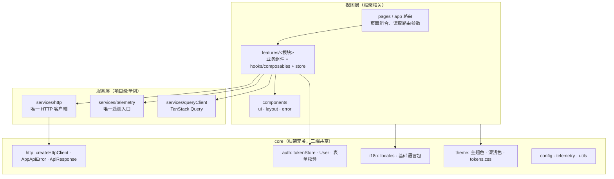
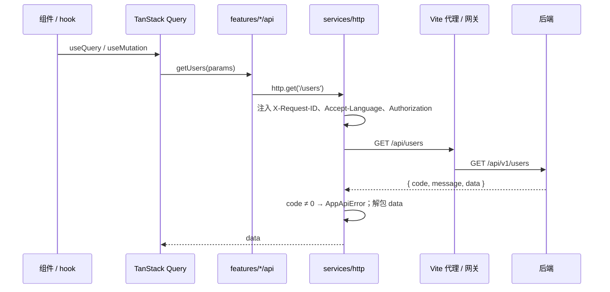
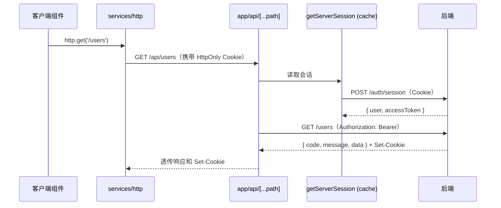
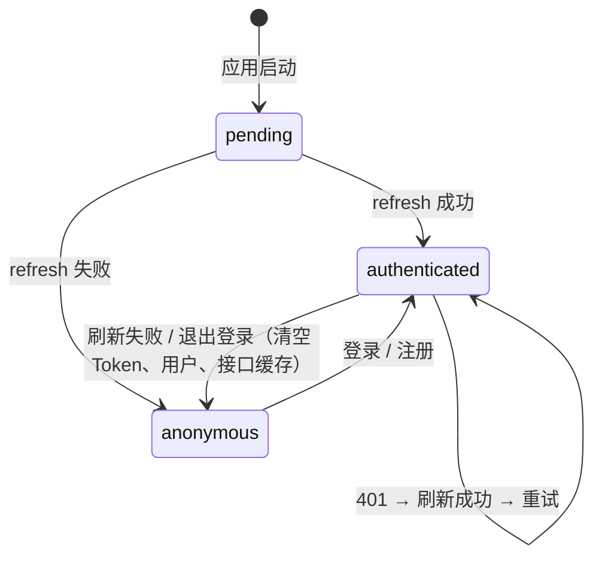
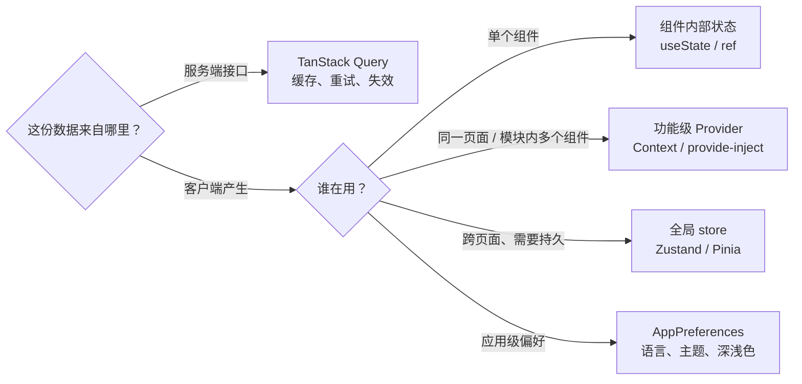
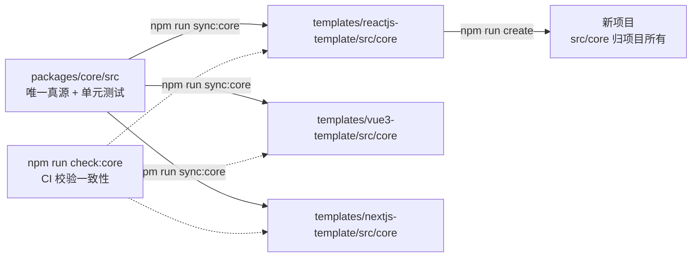
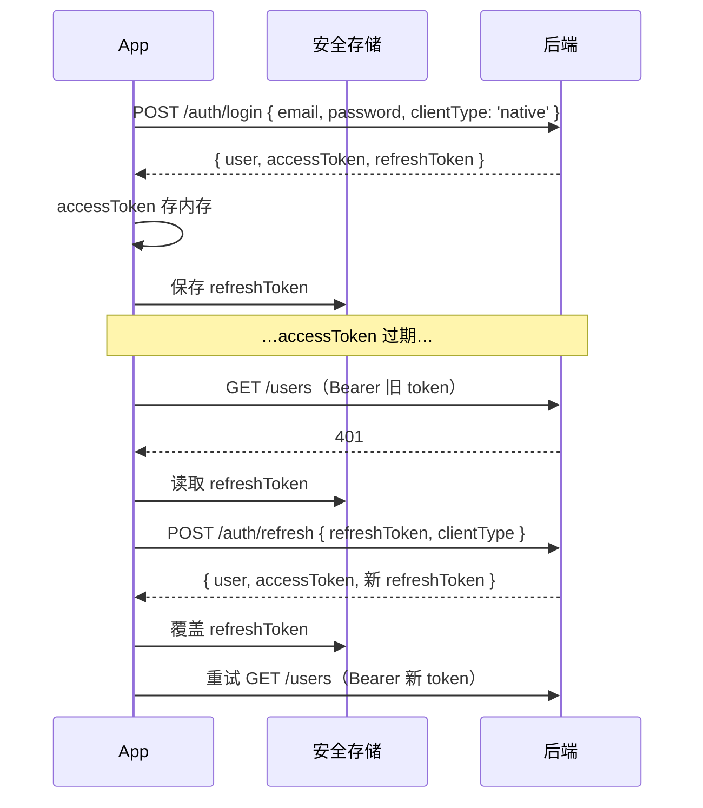

# 架构说明

六个模板（Web：React / Vue 3 / Next.js；跨端：uni-app / React Native / Flutter）使用**同一套分层、同一套目录语义、同一套基础能力**。换框架时，只有「视图层写法」不同，项目结构、请求方式、鉴权流程、状态边界、国际化和主题保持一致。前 6 节以 Web 模板为例，跨端模板的差异见第 7 节。

## 1. 分层

依赖方向只能**自上而下**：

- `core` 不依赖任何框架和项目代码，可以被任何层引用。
- `services` 只依赖 `core` 和 `config`，不依赖 `features`。
- `features/<A>` 不直接引用 `features/<B>` 的内部文件，只能引用对方 `index.ts` 暴露的能力。
- `pages` 只做组合，不写复杂业务逻辑。

## 2. 目录语义（三端对照）

| 目录                    | React SPA                          | Vue 3 SPA                                 | Next.js                                     | 说明                                    |
| ----------------------- | ---------------------------------- | ----------------------------------------- | ------------------------------------------- | --------------------------------------- |
| `src/core`              | ✓                                  | ✓                                         | ✓                                           | 框架无关基础层，由 `packages/core` 同步 |
| `src/config`            | `env.ts`                           | `env.ts`                                  | `env.ts` + `env.server.ts`                  | 环境变量唯一入口，zod 校验              |
| `src/services`          | `http` `telemetry` `queryClient`   | 同左                                      | 同左                                        | 项目级单例                              |
| `src/i18n`              | react-i18next                      | vue-i18n                                  | next-intl                                   | 基础语言包 + 项目文案                   |
| `src/features/<模块>`   | `api` `components` `hooks` `store` | `api` `components` `composables` `stores` | `api` `components` `hooks` `store` `server` | 业务模块，按功能内聚                    |
| `src/components/ui`     | shadcn/ui                          | 同名 Vue 组件（reka-ui）                  | shadcn/ui                                   | 无业务基础组件                          |
| `src/components/layout` | `MainLayout` `AppControls`         | 同左                                      | `AppShell` `AppControls` `NavLinks`         | 页面外壳                                |
| `src/components/error`  | `ErrorBoundary` `RouteErrorPage`   | `ErrorBoundary.vue`                       | `app/**/error.tsx`                          | 错误兜底                                |
| 页面                    | `src/pages` + `src/app/router.tsx` | `src/pages` + `src/app/router.ts`         | `src/app/[locale]/**/page.tsx`              | 路由与页面                              |
| 应用级 Provider         | `src/app/AppProviders.tsx`         | `main.ts` 插件                            | `src/providers/AppProviders.tsx`            | 偏好、接口缓存、登录态                  |
| 服务端                  | —                                  | —                                         | `src/server`、`src/app/api`                 | BFF 转发                                |
| `src/test`              | `render.tsx`                       | `mount.ts`                                | `render.tsx`                                | 测试工具                                |

## 3. 请求链路

### SPA（React / Vue）

### Next.js（BFF）

浏览器永远拿不到 accessToken。新增接口**不需要**新建 Route Handler：`app/api/[...path]` 会自动透传；只有需要裁剪字段、聚合多个接口时，才在 `app/api/` 下新建同名路由覆盖。

## 4. 鉴权

| 能力       | SPA（React / Vue）                                                              | Next.js                                                            |
| ---------- | ------------------------------------------------------------------------------- | ------------------------------------------------------------------ |
| 凭证       | accessToken 存内存（`tokenStore`），刷新凭证在 HttpOnly Cookie                  | 浏览器只有 HttpOnly Cookie，accessToken 只在服务端                 |
| 启动恢复   | `restoreSession()` 调用 `/auth/refresh`                                         | 服务端 layout 中 `getServerSession()`                              |
| 401 处理   | `httpClient` 自动刷新一次并重试；并发 401 只刷新一次                            | BFF 每次请求读取会话；客户端收到 401 清空状态并 `router.refresh()` |
| 路由守卫   | React：`RequireAuth` / `GuestOnly`；Vue：`meta.requiresAuth` / `meta.guestOnly` | 服务端 `requireSession()` / `redirectIfAuthenticated()`，无闪烁    |
| 登录后跳转 | `?redirect=` 参数，`getSafeRedirect()` 防开放重定向                             | 同左                                                               |

## 5. 状态边界

- 接口数据**不要**复制进 store；用 Query Key 工厂（如 `userKeys`）精确失效。
- 登录态是唯一默认放进全局 store 的业务状态。
- 退出登录时统一清空：Token、store、Query 缓存（见 `features/auth/session.ts`）。

## 6. core 同步机制

选择「复制」而不是 npm 包，是因为模板会被整体复制出去成为独立项目，新项目不应该依赖模板仓库。

## 7. 跨端模板（Android / iOS / H5）

### 7.1 目录对照

| 概念        | uni-app                                        | React Native（Expo）              | Flutter                                                |
| ----------- | ---------------------------------------------- | --------------------------------- | ------------------------------------------------------ |
| 页面 / 路由 | `src/pages` + `pages.json`                     | `src/app`（Expo Router 文件路由） | `lib/features/*/` + `lib/app/router.dart`（go_router） |
| 基础层      | `src/core`（同步）                             | `src/core`（同步）                | `lib/core`（Dart 实现 + 生成的 Token）                 |
| HTTP        | core `createHttpClient` + `uni.request` 适配器 | core `createHttpClient`（axios）  | `ApiClient`（dio）                                     |
| 鉴权        | core `createNativeAuthClient`                  | core `createNativeAuthClient`     | `AuthApi` + `AuthController`                           |
| 安全存储    | `uni.setStorage`                               | expo-secure-store                 | flutter_secure_storage                                 |
| 登录态      | Pinia                                          | Zustand                           | Riverpod Notifier                                      |
| 接口数据    | TanStack Vue Query                             | TanStack Query                    | FutureProvider                                         |
| 路由守卫    | 页面级 `useRequireAuth` / `useGuestOnly`       | `RequireAuth` / `GuestOnly` 组件  | go_router `redirect`                                   |
| 主题        | CSS 变量注入 `PageContainer`                   | `useAppTheme()`                   | `ThemeData` + `context.colors`                         |
| 语言包      | vue-i18n（core 语言包）                        | i18next（core 语言包）            | gen-l10n（由 core 生成 ARB）                           |
| H5          | `uni build`（H5）                              | `expo export --platform web`      | `flutter build web`                                    |

### 7.2 App 端鉴权

移动端没有 HttpOnly Cookie，三个跨端模板统一使用「请求体携带 refreshToken」模式（`clientType: 'native'`），后端在刷新时旋转 refreshToken：

- 冷启动时用 refreshToken 恢复会话（状态 `pending → authenticated / anonymous`）。
- 并发 401 只刷新一次；刷新失败清空 Token、用户和接口缓存，路由守卫自动跳转登录页。
- H5 版本没有安全存储，refreshToken 退化为 localStorage。对安全要求高的 H5 建议走 Next.js 的 BFF + HttpOnly Cookie 方案。

### 7.3 Flutter 如何与 core 保持一致

Flutter 无法直接运行 TypeScript，`npm run sync:core` 会从 core 生成：

- `lib/l10n/app_zh.arb`、`app_en.arb`：语言包（嵌套 key 转驼峰，如 `home.signedInAs` → `homeSignedInAs`，占位符类型 `Object`）；
- `lib/core/generated/design_tokens.g.dart`：语义色（浅色 / 深色）、品牌主题色、圆角、间距、字号、支持的语言。

HTTP 客户端、鉴权、表单校验规则按同一约定用 Dart 实现，行为差异在单元测试中对齐（`test/core/api_client_test.dart`）。
